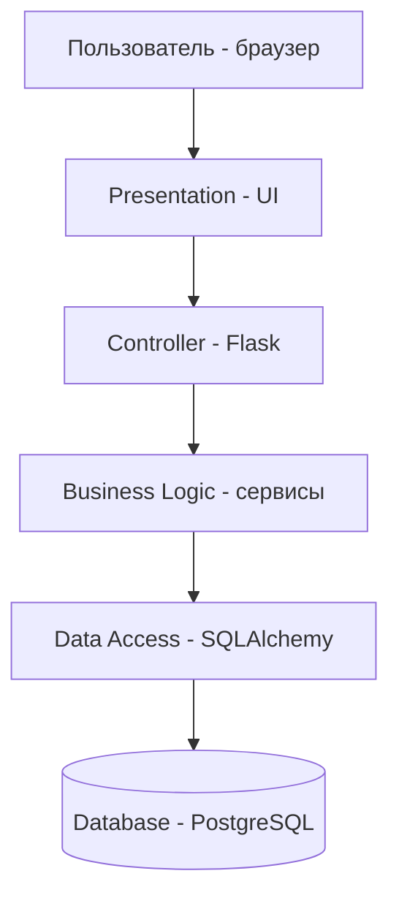
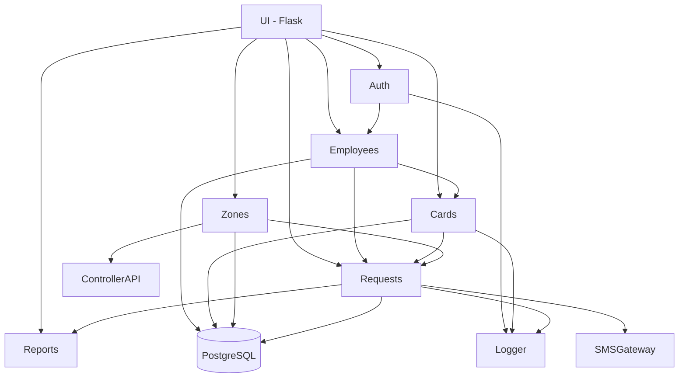

# Архитектура ИР

## Тип архитектуры

**Монолит + MVC + слоистая.**

## Обоснование

| Параметр | Значение |
|---|---|
| Масштаб | ≤ 500 пользователей/день |
| Команда | 1 разработчик |
| Сроки | 4 недели |
| Масштабируемость | Не критична |

**Почему монолит:** простота разработки и развёртывания для одного разработчика в короткие сроки.

**Почему MVC:** чёткое разделение логики (Model — данные, View — интерфейс, Controller — обработка запросов).

**Почему слоистая:** каждый слой отвечает за свою зону ответственности, легко тестировать и поддерживать.

**Почему не микросервисы:** избыточно для проекта такого масштаба, требует больше ресурсов и времени.

## Слои приложения

| Слой | Технология | Отвечает за |
|---|---|---|
| Presentation | HTML + Jinja2 | Отображение интерфейса |
| Controller / API | Flask | Обработка HTTP-запросов |
| Business Logic | Python-сервисы | Бизнес-правила (доступ, карты, события) |
| Data Access | SQLAlchemy | Работа с БД |
| Database | PostgreSQL | Хранение данных |

## Схема взаимодействия

## Модули приложения

### Бизнес-модули

| Модуль | Назначение | Взаимодействует с |
|---|---|---|
| Auth | Аутентификация, роли | Employees |
| Employees | Управление сотрудниками | Cards, Requests |
| Cards | Выдача, блокировка карт | Employees, StatusHistory |
| Zones | Зоны доступа, уровни | Controllers, Requests |
| Requests | Фиксация проходов, журнал | Cards, Zones, Controllers |
| Reports | Отчёты, экспорт | Requests, Cards |

### Инфраструктурные модули

| Модуль | Назначение |
|---|---|
| DB | Подключение к PostgreSQL, миграции |
| Config | Настройки приложения |
| Logger | Логирование событий |

### Интеграционные модули

| Модуль | Назначение |
|---|---|
| SMSGateway | Уведомления о нарушениях |
| ControllerAPI | Обмен с турникетами |

## Проверка coupling / cohesion

- **Coupling (связанность):** низкий — модули общаются через чёткие интерфейсы.
- **Cohesion (связность):** высокий — каждый модуль делает одно дело.
- **Циклических зависимостей нет.**

## Схема модулей

## UML-диаграмма компонентов

См. `diagrams/uml-component.png` (PNG) и `diagrams/uml-component.puml` (исходник).

**Компоненты:**
- Внутренние: Web UI, Admin UI, REST API, Auth, Employee, Card, Zone, Request, Report.
- Внешние: PostgreSQL, SMS Gateway, Controller API.